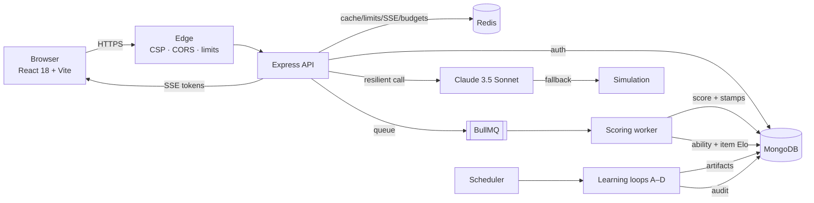
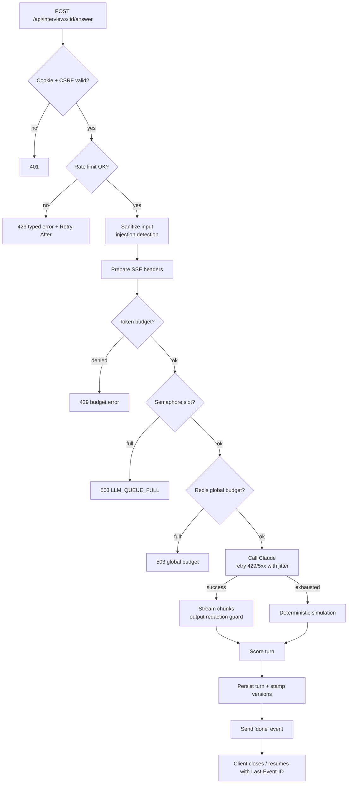
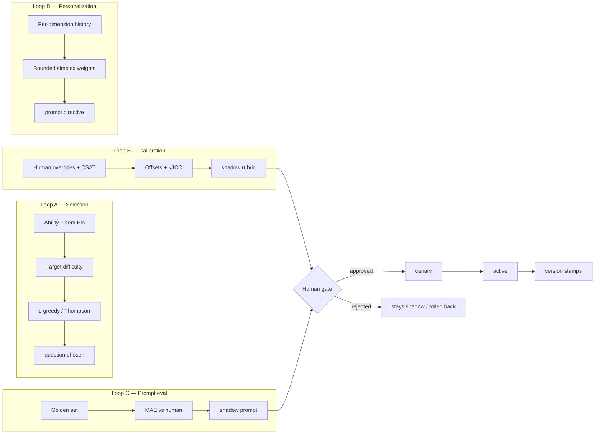
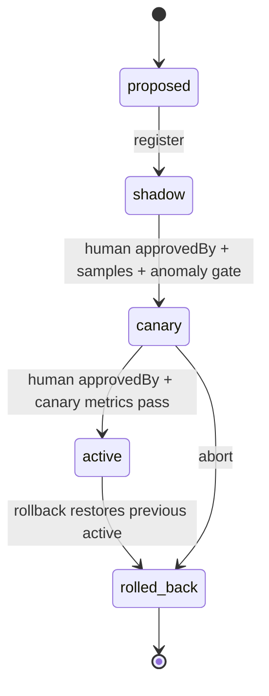
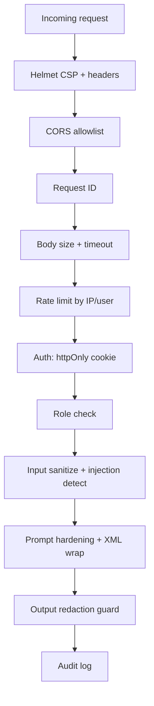

# 🚀 PrepAI — AI Mock Interview Platform

<p align="center">
  
  
  
  
  
  
  
  
</p>

<p align="center">
  <strong>Production-grade MERN mock-interview platform with live SSE streaming, hiring-committee scoring, 1,000-user scaling controls, and human-gated continuous learning.</strong><br/>
  <a href="#-quick-start-5-minutes">Quick Start</a> ·
  <a href="#-architecture">Architecture</a> ·
  <a href="#-continuous-learning-loops">Learning Loops</a> ·
  <a href="#-api">API</a> ·
  <a href="#-operations--slos">SLOs</a> ·
  <a href="DEPLOYMENT.md">Deployment</a> ·
  <a href="ROLLBACK.md">Rollback</a>
</p>

---

## 📖 Table of Contents

1. [What PrepAI does](#-what-prepai-does)
2. [Feature hologram](#-feature-hologram)
3. [Quick start (5 minutes)](#-quick-start-5-minutes)
4. [Architecture](#-architecture)
5. [Request lifecycle flowchart](#-request-lifecycle-flowchart)
6. [Continuous learning loops](#-continuous-learning-loops)
7. [Decision tree: adaptive question choice](#-decision-tree-adaptive-question-choice)
8. [Latency / capacity histogram](#-latency--capacity-histogram)
9. [Configuration](#-configuration)
10. [API](#-api)
11. [Testing](#-testing)
12. [Load testing & SLOs](#-load-testing--slos)
13. [Security model](#-security-model)
14. [Operations & rollback](#-operations--rollback)
15. [Troubleshooting](#-troubleshooting)
16. [Project layout](#-project-layout)

Adaptive interview scoring is slow work: a whole session has to be read, judged against a
rubric, and turned into feedback. Doing that inside the HTTP request is how a live
interview ends in a gateway timeout. PrepAI separates the conversation (fast, streaming)
from the evaluation (slow, queued, retryable) and treats them as two different problems.

## 🎯 What PrepAI does

PrepAI runs a realistic, multi-turn technical interview:

- **8 interview tracks** with dedicated, non-leaking rubrics: DSA, System Design, Behavioral, HR, Case Study, Product Management, Sales Pitch, Engineering Management.
- **Company + level calibration** (Google/Meta/Amazon/Stripe/Uber; L3 → L6+; India ₹LPA vs US $/yr).
- **Real-time SSE** token streaming with resume (`Last-Event-ID`), backpressure, and typed 429/503 shedding.
- **Hiring-committee scoring**: dimension scores, percentile, seniority fit, weak points, 7-day action plan.
- **Continuous learning A–D** that can never self-promote: `proposed → shadow → canary → active`, human approval required.
- **Graceful degradation by design**: no Redis, no Mongo, or no LLM key never crashes the request path.

---

## 🌈 Feature hologram

A “hologram” here is the layered view of the same product: each plane is independently deployable and observable.

```text
                    ┌──────────────────────────────────────────────┐
                    │            EXPERIENCE PLANE                  │
                    │  Landing · Dashboard · Interview Studio      │
                    │  3D orb · voice · code pad · feedback        │
                    └──────────────────────┬───────────────────────┘
                                           │ HTTPS / SSE
                    ┌──────────────────────▼───────────────────────┐
                    │              EDGE PLANE                      │
                    │  TLS · CSP · CORS · rate limits · request ID │
                    │  trust-proxy · timeout · audit · metrics     │
                    └──────────────────────┬───────────────────────┘
                                           │
        ┌──────────────────────────────────▼──────────────────────────────────┐
        │                           APPLICATION PLANE                         │
        │  Auth · Interview · Scoring queue · Analytics · Admin · Learning    │
        │  SSE registry · stream registry · connection registry               │
        └───────────────┬───────────────────────────────┬─────────────────────┘
                        │                               │
        ┌───────────────▼──────────────┐   ┌────────────▼────────────────────┐
        │        STATE PLANE           │   │           INTELLIGENCE PLANE     │
        │  MongoDB (source of truth)   │   │  Claude 3.5 Sonnet               │
        │  Redis (cache, limits, SSE,  │   │  per-instance semaphore          │
        │  token budgets, BullMQ)      │   │  global budget · retry · jitter  │
        └──────────────────────────────┘   └──────────────────────────────────┘
                        │
        ┌───────────────▼─────────────────────────────────────────────────────┐
        │                         LEARNING PLANE (off-path)                   │
        │  A selection · B calibration · C prompt eval · D personalization    │
        │  artifacts in proposed/shadow/canary/active · audit log · rollback  │
        └─────────────────────────────────────────────────────────────────────┘
```

**Reading the hologram:** a user request only touches Experience → Edge → Application → State/Intelligence. The Learning plane never sits on the request path; it consumes aggregates and writes versioned artifacts.

---

## ⚡ Quick start (5 minutes)

### Prerequisites

| Tool | Version | Required? |
|---|---|---|
| Node.js | ≥ 18 (20+ recommended) | ✅ Yes |
| npm | ≥ 9 | ✅ Yes |
| MongoDB | 6+ (local, Atlas, or replica set) | ✅ Yes |
| Redis | 6+ | ⚠️ Optional (fallback works) |
| Anthropic key | — | ⚠️ Optional (simulation works) |

### 1. Clone & install

```bash
git clone https://github.com/sheikhayaan/PrepAi.git
cd PrepAi
npm run install:all
```

### 2. Configure

```bash
cp .env.example server/.env
# edit server/.env
```

Minimum local values:

```dotenv
MONGO_URI=mongodb://127.0.0.1:27017/prepai
JWT_SECRET=local_dev_secret_at_least_32_characters_long
CLIENT_URL=http://localhost:5200
PORT=5000

# Optional — leave blank to use the deterministic simulation
ANTHROPIC_API_KEY=
REDIS_URL=redis://127.0.0.1:6379
```

Start MongoDB (and optionally Redis):

```bash
# macOS/Linux
mongod --dbpath ./data/db
redis-server

# Windows (services or portable binaries)
mongod --dbpath C:\data\db
redis-server
```

### 3. Run both apps

```bash
npm run dev
```

Open:

- Web: **http://localhost:5200** (if 5200 is busy, Vite auto-selects 5201/5202… and prints the URL)
- API: **http://localhost:5000**
- Health: **http://localhost:5000/api/health**
- Readiness: **http://localhost:5000/health/ready**
- Metrics: **http://localhost:5000/metrics**

### 4. Verify in 30 seconds

```bash
curl -s http://localhost:5000/api/health
curl -s http://localhost:5000/health/ready
curl -s http://localhost:5000/metrics | head
```

Expected readiness (with Mongo + Redis):

```json
{"status":"ready","checks":{"mongodb":"connected","redis":"connected","llm":"simulation"}}
```

### 5. Run the tests

```bash
npm test                     # learning loops + addendum (no DB needed)
npm run test:integration     # server must be running
npm run test:security        # audit + adversarial
```

### 6. Build for production

```bash
npm run build                # client/dist
NODE_ENV=production npm start
```

---

## 🏗️ Architecture



**Key invariants**

- Mongo is the source of truth; Redis is never required for correctness.
- LLM calls are budgeted three ways: per-user/day, per-session, and cluster-wide concurrency.
- Every score is attributable: `rubricVersion`, `weightsVersion`, `selectionPolicyVersion`, `promptVersion`.
- Learning artifacts are inert until a human promotes them.

---

## 🔄 Request lifecycle flowchart



**Failure semantics**

| Failure | Behavior |
|---|---|
| Redis down | Per-process cache/limits/SSE registry; app stays up |
| Mongo down | `/health` still 200; `/health/ready` 503; requests needing DB fail fast |
| LLM key absent | Deterministic simulation, no cost |
| LLM 429/5xx | Bounded exponential backoff + jitter, then simulation |
| Queue full | Typed `503` with `LLM_QUEUE_FULL` |
| Budget exhausted | Typed `429` with `TOKEN_BUDGET_EXCEEDED` |
| SSE limit | Typed `429` with `SSE_CONNECTION_LIMIT` |

---

## 🧠 Continuous learning loops

Four loops run **off the request path** (scheduler + BullMQ worker). Every artifact is versioned and human-gated.



### Artifact state machine



> **Guardrail:** `proposed → active` is forbidden. Sample-size and anomaly gates are enforced in `versionRegistry`. Every transition writes an `AuditLog`.

### Loop outputs

| Loop | Input | Output | Applied where |
|---|---|---|---|
| A | ability, question stats | next question | `selectionPolicy` at session start |
| B | human/CSAT feedback | rubric offsets | `scoringWorker` after scoring |
| C | golden set labels | prompt candidate | deploy `PROMPT_VERSION` after promotion |
| D | dimension history | readiness weights | analytics + interviewer directive |

---

## 🌳 Decision tree: adaptive question choice

```text
selectQuestion(user, type)
│
├─ adaptive enabled? ── no ──► random/default question
│
└─ yes
   ├─ ability known?
   │   ├─ no  ──► prior 1000 → target = 1000
   │   └─ yes ──► target = ability + offset
   │
   ├─ candidate pool
   │   ├─ filter: type matches
   │   ├─ filter: exposure cap not exceeded
   │   └─ filter: enough attempts? (else keep)
   │
   ├─ rank by |difficulty − target|
   │
   ├─ explore?
   │   ├─ ε-greedy  (ε = 0.1)
   │   └─ Thompson jitter
   │
   ├─ all exhausted? ──► fall back to static bank
   │
   └─ record exposure ──► return { question, policyVersion }
```

Tuning knobs: `ADAPTIVE_SELECTION_ENABLED`, `LEARNING_EXPLORATION_EPSILON`, `LEARNING_EXPOSURE_CAP_SHARE`, `LEARNING_MIN_ATTEMPTS`.

---

## 📊 Latency / capacity histogram

Sample local measurement (single instance, mocked LLM, 150 VUs read path + 20 interview VUs). Use it as a shape, not a guarantee.

```text
HTTP latency (ms), read path          count
  0–25   ████████████████████████████ 28,900
 25–50   ████                          4,100
 50–100  ██                            2,000
100–200  █                               900
200–400  ▏                               180
400–800  ▏                                40
800–2 s  ▏                                12
   > 2 s                                  2
```

```text
Throughput by plane (req/s, local)
Read API        ██████████████████████████████  ~140
Interview SSE   ███████                          ~20 streams
Scoring queue   ██                                ~7 jobs
LLM calls       ███                              ~30/min (simulation)
```

**Capacity rule of thumb**

| Resource | Safe starting point | Scale trigger |
|---|---|---|
| API instances | 2+ behind LB | CPU > 60% or p95 > 400 ms |
| Mongo pool | 5–25 per instance | wait queue > 0 |
| Redis | 1 primary + replica | ops latency > 5 ms |
| LLM concurrency | 50/instance, 200 global | queue depth sustained > 50 |
| SSE per instance | 5k (tune to memory) | active connections > 70% cap |

> Run `load-tests/` before changing any of these. Real numbers beat rules of thumb.

---

## ⚙️ Configuration

All variables live in `server/.env` (see [`.env.example`](.env.example) and [`server/.env.example`](server/.env.example)).

### Core

| Variable | Default | Notes |
|---|---|---|
| `NODE_ENV` | `development` | `production` enables strict validation |
| `PORT` | `5000` | API port |
| `MONGO_URI` | `mongodb://127.0.0.1:27017/prepai` | Required in production |
| `REDIS_URL` | `redis://127.0.0.1:6379` | Optional; set `REDIS_DISABLED=true` to force off |
| `JWT_SECRET` | — | ≥ 32 chars in production |
| `CLIENT_URL` | `http://localhost:5200` | Comma-separated allowlist |
| `TRUST_PROXY_HOPS` | `1` | Set to LB hop count; `0` on bare metal |

### LLM & cost

| Variable | Default | Notes |
|---|---|---|
| `ANTHROPIC_API_KEY` | empty | Empty = simulation |
| `ANTHROPIC_MODEL` | `claude-3-5-sonnet-20241022` | |
| `LLM_CONCURRENCY_PER_INSTANCE` | `50` | Semaphore |
| `LLM_QUEUE_MAX` | `200` | Bounded queue |
| `LLM_QUEUE_TIMEOUT_MS` | `15000` | Fast-fail |
| `LLM_GLOBAL_CONCURRENCY` | `200` | Redis-coordinated |
| `LLM_DAILY_TOKENS_PER_USER` | `120000` | Hard cap |
| `LLM_SESSION_TOKENS` | `30000` | Hard cap |
| `PROMPT_VERSION` / `RUBRIC_VERSION` | `2026.02.1` | Bump on promotion |

### Learning

| Variable | Default | Notes |
|---|---|---|
| `LEARNING_LOOPS_ENABLED` | prod: `true`, dev: `false` | Scheduler |
| `ADAPTIVE_SELECTION_ENABLED` | `false` | Opt-in |
| `LEARNING_*` | see env | Intervals, ε, caps, gates |

### SSE & limits

| Variable | Default | Notes |
|---|---|---|
| `SSE_MAX_PER_USER` | `2` | Concurrent streams |
| `SSE_MAX_PER_IP` | `10` | Behind proxy, requires `TRUST_PROXY_HOPS` |
| `RATE_LIMIT_*` | see env | Auth/start/answer/standard/admin buckets |

---

## 📡 API

Base: `http://localhost:5000/api`

### Auth

| Method | Path | Purpose |
|---|---|---|
| `POST` | `/auth/register` | Create account, set httpOnly cookie |
| `POST` | `/auth/login` | Login |
| `POST` | `/auth/logout` | Clear cookie |
| `GET` | `/auth/me` | Current user |

### Interview

| Method | Path | Purpose |
|---|---|---|
| `POST` | `/interviews/start` | Start session (type, tier, level, custom) |
| `POST` | `/interviews/:id/answer` | Submit answer → **SSE stream** |
| `POST` | `/interviews/:id/complete` | Complete + enqueue scoring → `{ jobId }` |
| `GET` | `/interviews` | Paginated history (`page`, `limit`) |
| `GET` | `/interviews/:id` | Session + final score |
| `GET` | `/interviews/questions` | Question bank (cached) |

### Analytics & admin

| Method | Path | Purpose |
|---|---|---|
| `GET` | `/analytics` | Readiness, trends, weak topics (short cache) |
| `GET` | `/admin/...` | Admin portal (auth + admin limiter) |
| `GET` | `/admin/learning/versions` | Active artifact versions |
| `POST` | `/admin/learning/prompt` | Register prompt candidate (shadow) |
| `POST` | `/admin/learning/evaluate` | Shadow evaluation |
| `POST` | `/admin/learning/promote` | Human-gated promotion |

### SSE resume

```js
const es = new EventSource(`/api/interviews/${id}/answer`);
// on reconnect the browser sends Last-Event-ID automatically;
// the server replays buffered events after that id.
```

### Quick API smoke test

```bash
# register
curl -i -c cookies.txt -X POST http://localhost:5000/api/auth/register \
  -H 'Content-Type: application/json' \
  -d '{"name":"Demo","email":"demo@example.com","password":"Password123!"}'

# start
curl -s -b cookies.txt -X POST http://localhost:5000/api/interviews/start \
  -H 'Content-Type: application/json' -d '{"type":"dsa"}'

# answer (SSE)
curl -N -b cookies.txt -X POST http://localhost:5000/api/interviews/<id>/answer \
  -H 'Content-Type: application/json' \
  -d '{"answer":"Sliding window with a hash map, O(n) time and O(k) space."}'
```

Redis and MongoDB are both optional to boot — Mongo is required for persistence, Redis
only upgrades scoring from in-process to durable.

## 🧪 Testing

```bash
npm test                                   # unit: learning loops + addendum
npm run test:integration                   # e2e (server on :5000)
npm run test:security                      # production audit + adversarial
node server/test-verification.js           # optional verification sweep
```

| Suite | What it proves |
|---|---|
| `test-learning-loops.js` | eligibility math, gates, illegal transitions, scheduler coverage |
| `test_addendum.js` | addendum checks |
| `test-e2e.js` | register → interview → SSE → complete → analytics |
| `test-production-audit.js` | cookies, authz, caching, SSE, scoring, no secret leakage |
| `test-adversarial-and-resilience.js` | injection neutralization, lazy-answer penalty, senior-answer reward |

**Last verified locally:** 21/21 learning checks, 5/5 addendum, 7/7 e2e, 11/11 audit, adversarial suite green.

---

## 📈 Load testing & SLOs

Install [k6](https://k6.io/docs/get-started/installation/), then:

```bash
# 1. run API with mocked LLM
cd server
unset ANTHROPIC_API_KEY
RATE_LIMIT_STANDARD_MAX=100000 RATE_LIMIT_START_MAX=5000 \
RATE_LIMIT_ANSWER_MAX=5000 SSE_MAX_PER_IP=1000 node server.js

# 2. seed users
BASE_URL=http://localhost:5000 USERS=200 node load-tests/seed-users.js

# 3. read + interview
k6 run load-tests/k6-mocked-llm.js

# 4. spike
k6 run load-tests/k6-spike.js

# 5. real SSE hold
USERS=150 node load-tests/sse-soak.js
```

| Signal | Target | Where |
|---|---|---|
| Read error rate | < 1% | k6 |
| Read p95 / p99 | < 400 ms / < 1 s | k6 |
| SSE failure | < 5% | k6 + soak |
| SSE TTFB p95 | < 4 s | soak |
| Spike 5xx | < 5% | k6 |
| Typed rejections | 429/503 with JSON code | k6 checks |

Server-side metrics: `GET /metrics`

```text
prepai_http_requests_total          prepai_http_request_duration_ms
prepai_llm_active                   prepai_llm_queue_depth
prepai_llm_queue_timeouts_total     prepai_llm_global_active
prepai_llm_global_budget_rejected_total
prepai_sse_active_connections       prepai_sse_limit_rejected_total
prepai_token_budget_denied_total
prepai_learning_*                   prepai_cache_hits_total
```

**Local sample (mocked LLM):** 150 VUs → 0% failures, p95 ≈ 171 ms; 400 VU spike → 0 server 5xx, p95 ≈ 9 ms; 50 concurrent SSE → 0 failures, TTFB p95 ≈ 413 ms.

---

## 🛡️ Security model



- **Auth:** JWT in httpOnly, `SameSite=Lax`, Secure in production.
- **Passwords:** bcrypt cost 12; login lockout with progressive delay.
- **Injection:** pattern detection, XML escaping, hardened system directive, deterministic adversarial penalty.
- **Secrets:** never returned in API payloads; env-only.
- **Admin:** separate limiter bucket + role gate + audit trail.
- **Headers:** CSP, HSTS (prod), `X-Content-Type-Options`, `Referrer-Policy`, `X-Frame-Options`.
- **SSE:** per-user/per-IP caps, drain on deploy, resume via `Last-Event-ID`.

See [`DEPLOYMENT.md`](DEPLOYMENT.md) for the full checklist.

---

## 🔁 Operations & rollback

### Health & readiness

| Endpoint | Meaning |
|---|---|
| `GET /api/health` | Liveness (always 200 if process is alive) |
| `GET /health/ready` | Mongo/Redis/LLM + SSE + queue + budget snapshot |
| `GET /metrics` | Prometheus text |

### Graceful shutdown

On `SIGTERM` the server:

1. Marks SSE draining and stops accepting new streams.
2. Rejects queued LLM waiters (`503`).
3. Drains BullMQ and closes Mongo/Redis.
4. Force-exits after `SHUTDOWN_FORCE_MS`.

LB should allow **≥ 30 s** drain.

### Rollback

```bash
# learning artifact
curl -X POST /api/admin/learning/rollback \
  -H 'Content-Type: application/json' -b admin_cookies.txt \
  -d '{"kind":"rubric","version":"2026.02.1","reason":"regression"}'

# app
git revert <sha> && npm run build && restart
```

Full procedure: [`ROLLBACK.md`](ROLLBACK.md).

---

## 🧯 Troubleshooting

| Symptom | Likely cause | Fix |
|---|---|---|
| `/health/ready` 503 `mongodb: disconnected` | Mongo down / wrong URI | start Mongo, check `MONGO_URI` |
| `redis: degraded` | Redis unreachable | start Redis or set `REDIS_DISABLED=true` |
| All answers `400 Answer content is required` | missing `Content-Type: application/json` | add header |
| `429 RATE_LIMIT_EXCEEDED` | shared IP bucket | raise limits only for load tests |
| `503 LLM_QUEUE_FULL` | semaphore saturated | scale instances or raise concurrency after provider check |
| SSE stalls behind proxy | buffering on | `proxy_buffering off`, `X-Accel-Buffering: no` |
| Wrong client IP in limits | proxy hops | set `TRUST_PROXY_HOPS` |
| `MONGO_SECONDARY_READS=true` fails | standalone Mongo | use replica set or set `false` |
| Scores look generous in dev | live LLM enabled | unset `ANTHROPIC_API_KEY` for deterministic tests |

---

## 📁 Project layout

```text
PrepAi/
├─ client/                     React 18 + Vite + Tailwind
│  ├─ src/pages/              Landing, Dashboard, Interview, Results, Admin…
│  ├─ src/store/              Zustand stores
│  └─ src/api/                Axios client
├─ server/
│  ├─ server.js               Express bootstrap + health/metrics
│  ├─ src/config/             env, db, indexes
│  ├─ src/controllers/        auth, interview, analytics, admin
│  ├─ src/jobs/               BullMQ queue + scoring worker
│  ├─ src/learning/           loops A–D + registry + statistics
│  ├─ src/middleware/         auth, rate limit, timeout, telemetry
│  ├─ src/models/             Mongoose models
│  ├─ src/routes/             API routes
│  ├─ src/services/           Claude client, resilience, budgets
│  ├─ src/sse/                stream + connection registries
│  ├─ src/utils/              cache, metrics, security, logger
│  └─ test-*.js               integration / security / learning suites
├─ load-tests/                k6 + SSE soak + seed script
├─ .github/workflows/         CI (health-gated e2e)
├─ DEPLOYMENT.md
├─ ROLLBACK.md
└─ README.md
```

---

## 🧭 Design decisions (why it is built this way)

1. **Mongo is truth, Redis is acceleration.** Any Redis failure degrades performance, never correctness.
2. **LLM calls are a scarce resource.** Three independent guards (per-user, per-session, cluster) plus a bounded queue and deterministic fallback.
3. **Scoring is off the request path.** Completion returns `jobId`; the worker applies calibration, ability, item Elo, and version stamps.
4. **Learning cannot self-promote.** Artifacts must pass gates and a human approval; illegal transitions are rejected in code and covered by tests.
5. **Every score is reproducible.** Session stores `rubricVersion`, `weightsVersion`, `selectionPolicyVersion`, `promptVersion`.
6. **Typed failure is a feature.** 429/503 responses carry machine-readable codes so clients can back off intelligently.
7. **SSE is first-class.** Resume, redaction hold-back, per-IP caps, and drain-on-deploy are built in, not bolted on.

---

## Limits

**Sheikh Ayaan** — [@sheikhayaan](https://github.com/sheikhayaan)

Built as a production-oriented reference implementation for AI interview systems: streaming UX, cost control, horizontal scaling, and safe continuous learning.
