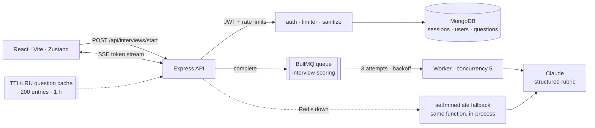

# PrepAI

**AI mock interviews across eight tracks, graded against per-track rubrics — with the grading done off the request path.**

A candidate starts a session, answers over a streaming connection, and gets a scored
debrief: per-dimension scores, an overall band, a percentile, and a seven-day plan. The
scoring is a queued job, so a slow model never holds an interview connection open.

`React 18` `Vite` `Tailwind` `Node` `Express` `MongoDB` `BullMQ` `Redis` `Claude`

> No hosted demo — every session costs provider tokens. The repo ships the test scripts;
> run them against your own key.

---

## Why this exists

Adaptive interview scoring is slow work: a whole session has to be read, judged against a
rubric, and turned into feedback. Doing that inside the HTTP request is how a live
interview ends in a gateway timeout. PrepAI separates the conversation (fast, streaming)
from the evaluation (slow, queued, retryable) and treats them as two different problems.

## Architecture



### Request path

1. `POST /api/interviews/start` creates a session document and asks the model for an
   opening question — served from a cache when the same configuration was seen before.
2. `POST /api/interviews/:id/answer` streams the adaptive follow-up token-by-token over
   SSE (`text/event-stream`, `chunk` → `done`), so the candidate sees thinking, not a
   spinner.
3. `POST /api/interviews/:id/complete` enqueues `interview-scoring` with the session id
   and returns immediately.
4. The worker loads the session, scores it against the track's rubric with a structured
   tool call, and writes `finalScore`, `completedAt` and `status: completed` back onto the
   same document.

## Design decisions

1. **Scoring is a job, not request work.** `POST /complete` returns as soon as the job is
   accepted; three attempts with exponential backoff (2 s) absorb a provider hiccup that
   would otherwise be a lost interview.
2. **Redis is optional, not assumed.** `addScoringJob()` falls back to `setImmediate` with
   the *same* `processScoringJob` function when the broker is unreachable, so local
   development needs no infrastructure while production still gets retries and a
   concurrency cap of 5. One code path, two durability levels — and the degradation is
   logged, not silent.
3. **Rubrics are per-track, not one global rubric.** DSA is scored on correctness and edge
   cases; system design on trade-offs and fault tolerance; behavioural on STAR structure
   and quantified ownership; consulting on MECE structuring and hypothesis-driven
   reasoning. Each track carries a role description for the grader
   (`Principal Algorithmist & Software Bar Raiser`, `Principal Distributed Systems
   Architect`, …), so the same model behaves like different interviewers.
4. **A cache in front of the model.** Opening questions repeat across users for the same
   `sessionType:companyTier:targetCompany:seniorityLevel` tuple, so a TTL/LRU cache (200
   entries, one hour, oldest-first eviction) removes a class of identical API calls
   without changing behaviour.
5. **Rate limits where money is spent.** Auth is capped at 20 requests / 15 min, session
   start at 15 / 10 min, and answer submission at 40 / 5 min per IP — the three routes
   that can run up a bill.
6. **Fail loudly at boot, not mid-interview.** The Anthropic client initialises only on a
   plausible key; without one the server runs in an explicitly logged local simulation
   mode rather than throwing on the first request.

## Project layout

```
client/                 React + Vite: pages, stores, SSE consumer, visual components
server/server.js        Express app: helmet, CORS allowlist, mongo-sanitize, routes
server/src/routes       auth · interviews · analytics · admin · ratings
server/src/jobs         scoringQueue (BullMQ + fallback) · scoringWorker
server/src/services     anthropicClient (rubrics, structured tool call)
server/src/models       User · InterviewSession · QuestionBank · Rating
server/test-*.js        e2e · adversarial · production audit · verification
```

## Quick start

```bash
# API
cd server
npm install
cp ../.env.example .env      # MONGO_URI, JWT_SECRET, ANTHROPIC_API_KEY, REDIS_URL, CLIENT_URL
npm run dev                  # :5000  (npm run seed for the question bank)

# client
cd ../client
npm install
npm run dev                  # :5173
```

Redis and MongoDB are both optional to boot — Mongo is required for persistence, Redis
only upgrades scoring from in-process to durable.

## Tests

```bash
cd server
node test-e2e.js
node test-adversarial-and-resilience.js
node test-production-audit.js
```

These hit a running server and a database: they cover the full session lifecycle, hostile
input, and resilience when the queue or provider is unavailable.

## Limits

- **No hosted demo**, by design: a public link would spend someone's tokens.
- **The rubric is only as good as one model.** There is no human calibration set and no
  inter-rater agreement measurement; the scores should be read as structured feedback, not
  as a hiring verdict.
- **The cache is in-process.** Two API instances do not share it, and a restart clears it.
- **Single-tenant**: one deployment, one Mongo, no per-organisation isolation.

## Author

**Mohd Ayaan** — [github.com/sheikhayaan](https://github.com/sheikhayaan) ·
[LinkedIn](https://linkedin.com/in/mohd-ayaan-7731b4381)
