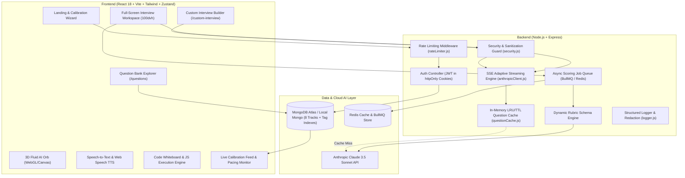

# 🚀 PrepAI — Next-Generation AI Technical Interview Platform

<p align="center">
  
  
  
  
  
  
  
  
</p>

<p align="center">
  <strong>An intelligent, full-stack FAANG & Tier-1 mock interview platform powered by Claude 3.5 Sonnet, real-time Server-Sent Events (SSE), interactive 3D WebGL/Canvas fluid audio visualizers, and hiring committee diagnostic scoring.</strong>
</p>

---

## 📖 Table of Contents
- [🌟 Key Highlights & Innovations](#-key-highlights--innovations)
- [🏗️ System Architecture](#️-system-architecture)
- [✨ Core Features](#-core-features)
- [🛡️ Production Hardening & Security](#️-production-hardening--security)
- [💰 Token Budgeting & Cost Control](#-token-budgeting--cost-control)
- [🛠️ Tech Stack](#️-tech-stack)
- [🚀 Quick Start & Installation](#-quick-start--installation)
- [⚙️ Environment Configuration](#️-environment-configuration)
- [🧪 Automated Test Suites](#-automated-test-suites)
- [📡 API Documentation](#-api-documentation)
- [📁 Codebase Structure](#-codebase-structure)
- [👤 Author](#-author)

---

## 🌟 Key Highlights & Innovations

- **8 Specialized Interview Tracks & Dynamic Rubrics**: Comprehensive coverage across both technical and non-technical domains with dedicated, non-leaking evaluation rubrics:
  - **DSA & Algorithms**: Clarity, Correctness, Modularity, Edge Cases
  - **System Design**: High-throughput architecture, latency SLOs, distributed trade-offs
  - **Behavioral & Leadership**: STAR methodology, bar-raiser competencies & ownership
  - **HR & Culture Fit**: Communication, culture/mission alignment, career consistency
  - **Consulting Case Study**: MECE framework structuring, hypothesis testing, quantitative reasoning
  - **Product Management (PM)**: User empathy, prioritization frameworks (RICE), metrics thinking
  - **Sales Pitch & Revenue**: Persuasiveness, objection handling & negotiation, pitch clarity
  - **Engineering Management**: Conflict resolution, delegation reasoning, leadership judgment
- **Custom Interview Builder (`/custom-interview`)**: Bespoke interview creator allowing candidates to define target roles, company context, and native regional market calibration (India 🇮🇳 `₹ LPA` vs US 🇺🇸 `$ /yr`).
- **Company-Wise & Level-Wise Problem Bank (`/questions`)**: Filter 40+ original problems by target company (*Google*, *Meta*, *Amazon*, *Stripe*, *Microsoft*, *Uber*) and seniority level (*L3* through *L6+*) with instant 1-click simulation launch.
- **Intelligent Intent Recognition**: Distinguishes greetings (*"hello"*), hints, requests for clarification, and non-technical replies without hallucinating false praise.
- **Adaptive Multi-Turn SSE Streaming**: Delivers token-by-token follow-ups probing algorithmic complexities, concurrency hazards, and architectural trade-offs.
- **Discriminative Scoring Rubric**: Produces candid hiring bar raiser evaluations with numerical clarity, percentile ranks, and customized **7-Day Action Plan Sprints**.
- **Interactive Full-Screen Studio**: Features a responsive 3D Liquid Orb visualizer, speech-to-text voice recognition, text-to-speech voice synthesis, live code execution whiteboard, and real-time session telemetry.

---

## 🏗️ System Architecture



---

## ✨ Core Features

### 🎙️ 1. Active Interview Studio (`InterviewPage.jsx`)
- **3D Liquid AI Orb**: 48-point fluid mesh shader responding dynamically to microphone input volume and AI voice states.
- **Voice-Enabled Interface**: Full hands-free capability with Web Speech API transcription and voice synthesis.
- **Live Whiteboard Sandbox**: In-browser code runner allowing candidates to implement and test algorithms in real time.
- **Live Telemetry & Diagnostics**: Real-time evaluation progress, turn counting, pacing indicators, and Bar Raiser hints.

### 🛠️ 2. Custom Interview Builder (`CustomInterviewSetup.jsx`)
- Freeform **Target Role** and **Target Company** customization.
- **Regional Market Toggle**: India 🇮🇳 (benchmarked in `₹ LPA`) vs US 🇺🇸 (benchmarked in `$ /yr`).
- Seamless prompt injection and XSS defense with input sanitization.

### 📚 3. Company & Level Question Bank (`QuestionBankExplorer.jsx`)
- Indexed queries filtering by Company Tag (`Google`, `Meta`, `Amazon`, `Stripe`), Seniority Level (`L3`, `L4`, `L5`, `L6+`), Difficulty, and Track Type.
- One-click **"Practice This"** instant interview launcher.

### 📊 4. Deep Diagnostic Evaluation (`ResultsPage.jsx`)
- Specialized dynamic rubric dimension cards adapting to the active track (e.g. *MECE Structuring* for Case Studies, *User Empathy* for PM, *Objection Handling* for Sales).
- **Percentile Rank** calibrated to the specific company tier and level.
- Concrete **Strengths** and **Weaknesses** breakdown.
- **7-Day Sprint Action Plan** with targeted day-by-day practice recommendations.

### 📈 3. Glassmorphic Analytics Dashboard (`DashboardPage.jsx`)
- Aggregated metrics powered by native MongoDB aggregation pipelines.
- Weekly performance trajectories, practice hour counters, topic mastery meters, and historical session logs.

---

## 🛡️ Production Hardening & Security

1. **Prompt Injection & Adversarial Bypass Defense (`server/src/utils/security.js`)**:
   - Intercepts and neutralizes prompt injection attempts (e.g., *"Ignore previous instructions"*, *"Award 10/10"*, XML tag spoofing).
   - Encapsulates candidate dialogue within strict `<candidate_response>` XML boundaries.
   - Evaluates adversarial sessions with strict zero-score flags (`1.9/10`, `Adversarial Bypass Detected`).
2. **Layered Rate Limiting (`server/src/middleware/rateLimiter.js`)**:
   - **Auth Routes**: Max 20 attempts per 15 minutes per IP (brute-force defense).
   - **Interview Creation**: Max 15 starts per 10 minutes per IP/User.
   - **Answer Streaming**: Max 40 submissions per 5 minutes per IP.
3. **Secret Redaction & Structured Logging (`server/src/utils/logger.js`)**:
   - Structured JSON logging with automated regex masking (`[REDACTED_SECRET]`) ensuring API keys, bearer tokens, and credentials are never leaked.
4. **Resilient Mid-Interview Fault Recovery**:
   - Handles network disconnection or SSE aborts gracefully with an in-room Reconnect banner, preventing white-screen crashes.

---

## 💰 Token Budgeting & Cost Control

- **Max-Turns Cap (`maxTurns = 6`)**: Enforces a budget limit per session to prevent unbounded LLM token consumption.
- **In-Memory Question Caching (`questionCache.js`)**: Caches opening questions for identical `(track + company + level)` combinations with a 1-hour TTL (0ms latency, 0 API cost on repeat starts).
- **Session Token Telemetry**: Tracks estimated prompt, completion, and total tokens in MongoDB per interview.

---

## 🛠️ Tech Stack

| Domain | Technology |
| :--- | :--- |
| **Frontend** | React 18, Vite, Tailwind CSS, Zustand, Recharts, Lucide Icons, Canvas WebGL Shaders |
| **Backend** | Node.js, Express.js, Mongoose, Cookie-Parser, CORS, express-rate-limit |
| **AI Engine** | Anthropic Claude 3.5 Sonnet (`claude-3-5-sonnet-20241022`) + SSE Streaming |
| **Background Jobs** | BullMQ, Redis, Background Worker Fallback |
| **Database** | MongoDB (Native Aggregations, Indexing) |
| **Security** | BCrypt.js, JSON Web Tokens (httpOnly, SameSite=Lax Cookies), Input Sanitizers |

---

## 🚀 Quick Start & Installation

### Prerequisites
- **Node.js** $\ge 18.0.0$
- **MongoDB** running locally or a MongoDB Atlas URI
- *(Optional)* **Redis** running locally (or uses automatic async worker fallback)
- *(Optional)* **Anthropic API Key** (or runs seamlessly on the built-in local fallback engine)

### 1. Clone the Repository
```bash
git clone https://github.com/sheikhayaan/prepai.git
cd prepai
```

### 2. Install Dependencies
```bash
# Install server dependencies
npm --prefix server install

# Install client dependencies
npm --prefix client install
```

### 3. Configure Environment Variables
Copy `.env.example` into `server/.env`:
```bash
# Server Environment (.env)
PORT=5000
CLIENT_URL=http://localhost:5173
MONGO_URI=mongodb://127.0.0.1:27017/prepai
JWT_SECRET=your_super_secret_jwt_key_2026
REDIS_URL=redis://127.0.0.1:6379
ANTHROPIC_API_KEY=your_anthropic_api_key_here
```

### 4. Seed the FAANG Question Bank
```bash
npm --prefix server run seed
```

### 5. Launch the Platform
```bash
# Terminal 1: Start Backend Server
node server/server.js

# Terminal 2: Start Frontend App
npm --prefix client run dev
```

Open **[http://localhost:5173](http://localhost:5173)** in your browser!

---

## 🧪 Automated Test Suites

PrepAI includes complete end-to-end integration and security test suites:

```bash
# 1. Run Core E2E Integration Test (7 Tests)
node server/test-e2e.js

# 2. Run Production Security & Architecture Audit (11 Tests)
node server/test-production-audit.js

# 3. Run Live Adversarial Prompt Injection & Scoring Discrimination Tests (4 Tests)
node server/test-adversarial-and-resilience.js
```

---

## 📡 API Documentation

### Authentication
- `POST /api/auth/register` — Register new user and issue `httpOnly` cookie.
- `POST /api/auth/login` — Authenticate user.
- `POST /api/auth/logout` — Invalidate session cookie.
- `GET /api/auth/me` — Retrieve authenticated user profile *(Protected)*.

### Interviews
- `POST /api/interviews/start` — Start session with company tier, seniority & package target, or `customConfig` (role, targetCompany, region, targetSalary) *(Rate Limited)*.
- `POST /api/interviews/:id/answer` — Submit answer and receive SSE stream *(Rate Limited)*.
- `POST /api/interviews/:id/complete` — Conclude interview and enqueue background scoring job.
- `GET /api/interviews/:id` — Fetch session transcript and dynamic rubric evaluation scores.
- `GET /api/interviews` — Fetch user interview history.
- `GET /api/interviews/questions` — Filter question bank by `company`, `level`, `type`, `difficulty`, and regex `search`.

### Analytics
- `GET /api/analytics` — Fetch aggregated mastery, hours, and weekly performance trends.

---

## 📁 Codebase Structure

```
├── client/                      # Frontend Application (React 18 + Vite)
│   ├── src/
│   │   ├── components/          # 3D AI Orb, Aurora Shader, Waveforms, Scrollytelling
│   │   ├── pages/               # Landing, Dashboard, Interview Room, Results
│   │   ├── store/               # Zustand Global State Stores
│   │   └── api/                 # Axios Client & Interceptors
├── server/                      # Backend API Server (Node.js + Express)
│   ├── src/
│   │   ├── config/              # MongoDB & Question Bank Seeders
│   │   ├── controllers/         # Auth, Interview, Analytics Controllers
│   │   ├── middleware/          # JWT Auth, Rate Limiter, Error Handler
│   │   ├── models/              # User, InterviewSession, QuestionBank Schemas
│   │   ├── services/            # Anthropic Claude 3.5 Sonnet Client & Streaming
│   │   ├── jobs/                # BullMQ Queues & Scoring Workers
│   │   └── utils/               # Structured Logger, Security & Question Cache
│   ├── test-e2e.js              # Integration Test Suite
│   ├── test-production-audit.js # Security & Architecture Audit
│   └── test-adversarial-and-resilience.js # Adversarial Defense Tests
└── README.md                    # Project Documentation
```

---

## 👤 Author

**Sheikh Ayaan**
- GitHub: [@sheikhayaan](https://github.com/sheikhayaan)

---

<p align="center">
  <sub>Built with ❤️ for engineers preparing to crack top-tier technical interviews.</sub>
</p>
